<div align="center">

# nino-nixos

**A NixOS laptop that feels alive.**<br>
Flakes + home-manager · Hyprland configured in Lua · a hand-tuned Quickshell desktop · and a pixel crab that reacts to Claude Code.


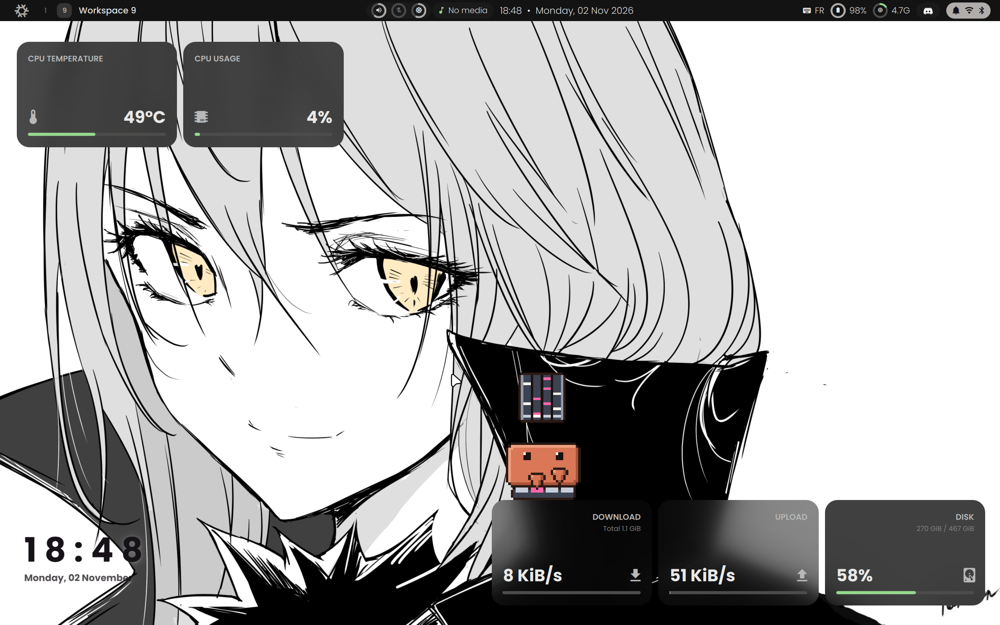

</div>

## Highlights

- **A shell built for this machine.** Status bar, launcher, control and utility centers, energy and memory panels, notifications, OSD, lock screen and greeter, all in QML. Panels melt out of the screen edges as one liquid surface.
- **Colors that follow the wallpaper.** Pick a wallpaper and the shell, GTK, Qt and kitty themes are regenerated from it.
- **A desktop worth looking at.** Movable floating cards for clock, weather, calendar, CPU/GPU, air quality, network and disk sit right on the wallpaper.
- **Clawd.** A pixel-art crab lives on the desktop, jumps between widgets and acts out what Claude Code is doing in real time.
- **Battery-aware.** Three power profiles drive CPU limits, Wi-Fi power save, the refresh rate (240 ↔ 60 Hz) and visual effects in one click, and the dGPU stays powered off until something asks for it.

## A tour of the shell

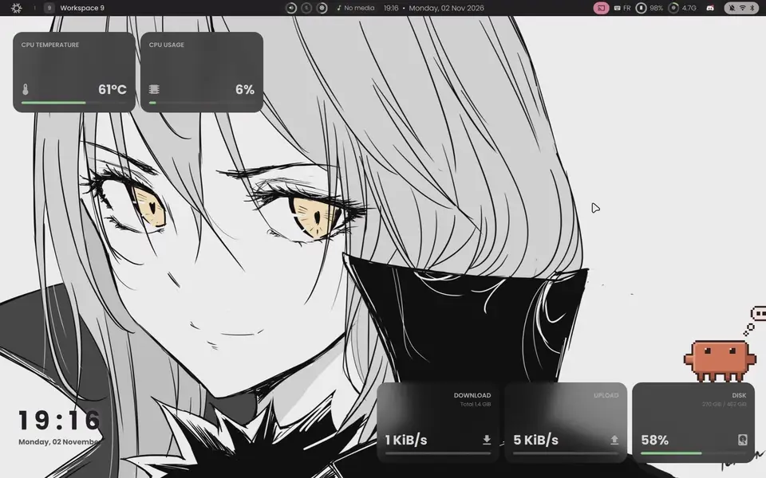

<p align="center"><b>Wallpaper picker</b> (<kbd>Super</kbd>+<kbd>W</kbd>): a new wallpaper sweeps in and the whole desktop is recolored from it.</p>

<table>
  <tr>
    <td width="50%">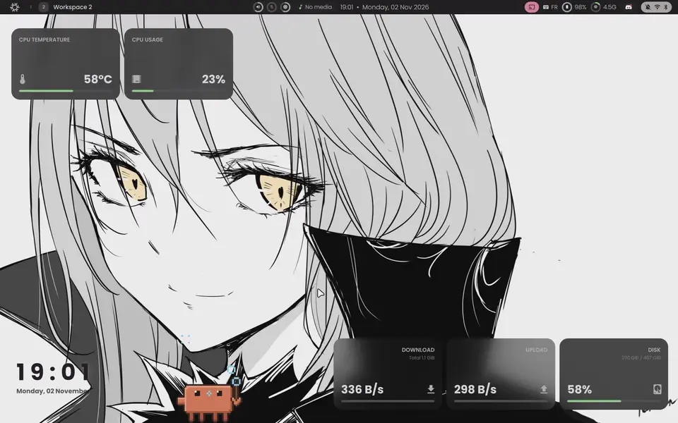</td>
    <td width="50%">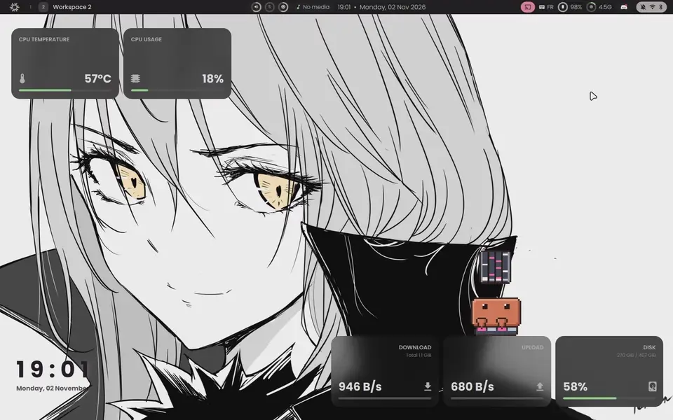</td>
  </tr>
  <tr>
    <td><b>Launcher</b>: apps, commands and clipboard history (<kbd>Super</kbd>+<kbd>D</kbd>, <kbd>Super</kbd>+<kbd>V</kbd>).</td>
    <td><b>Bar panels</b>: memory, power profiles, notifications and calendar, power menu, media and volume.</td>
  </tr>
  <tr>
    <td>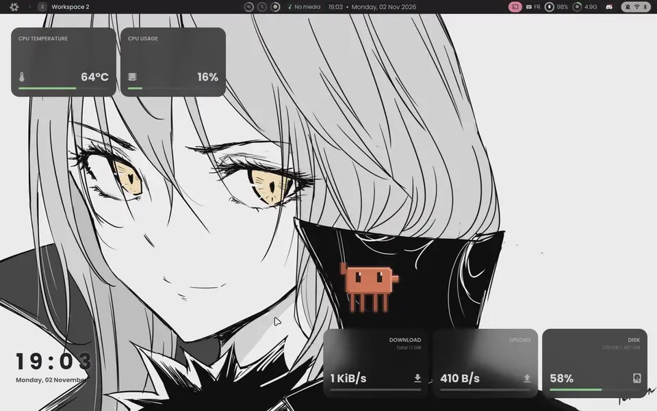</td>
    <td>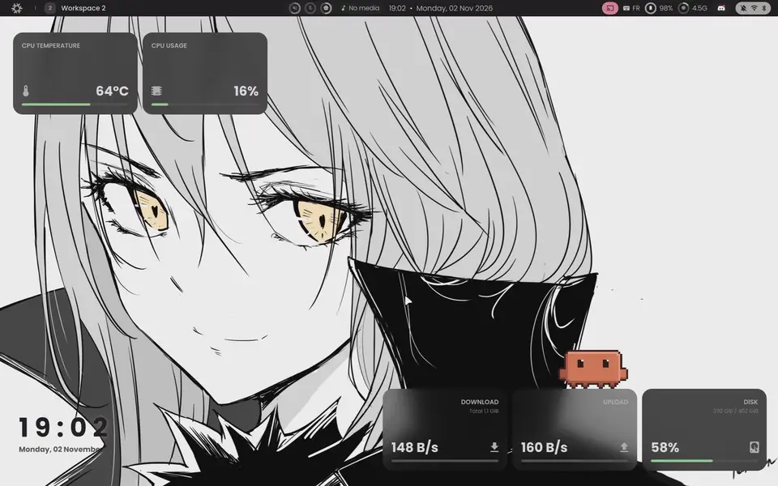</td>
  </tr>
  <tr>
    <td><b>Hyprland</b>: dwindle tiling, configured in Lua.</td>
    <td><b>Keybind cheatsheet</b> (<kbd>Super</kbd>+<kbd>F1</kbd>), generated live from the bind descriptions in <code>hyprland.lua</code>.</td>
  </tr>
</table>

<details>
<summary><b>Settings app</b></summary>
<br>
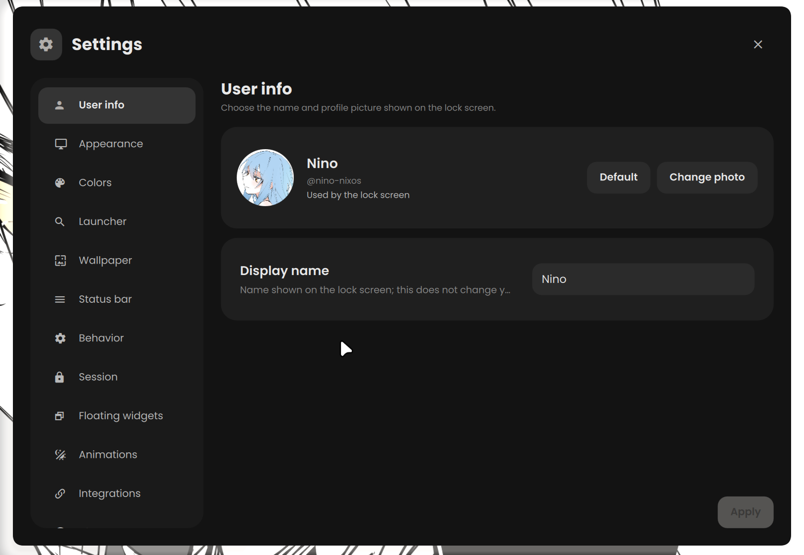

Appearance, colors, launcher, wallpaper, bar, session, floating widgets, animations and app integrations are all editable from the shell itself. Runtime settings live outside the repo, so tweaking them never dirties the config.
</details>

The shell is a Hyprland port of [JAQC-shell](https://github.com/MystiaFin/JAQC-shell) by MystiaFin, extended with the energy and memory panels, the keybind cheatsheet, more desktop widgets and Clawd.

## Meet Clawd

<table>
  <tr>
    <td width="50%">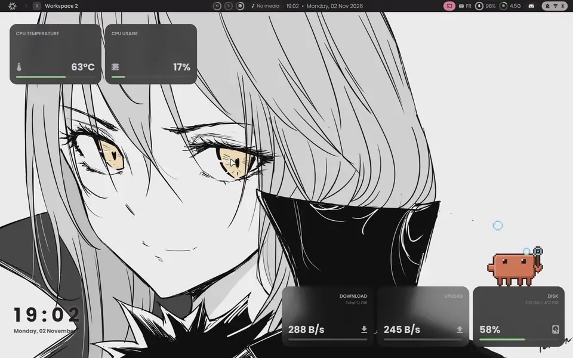</td>
    <td width="50%">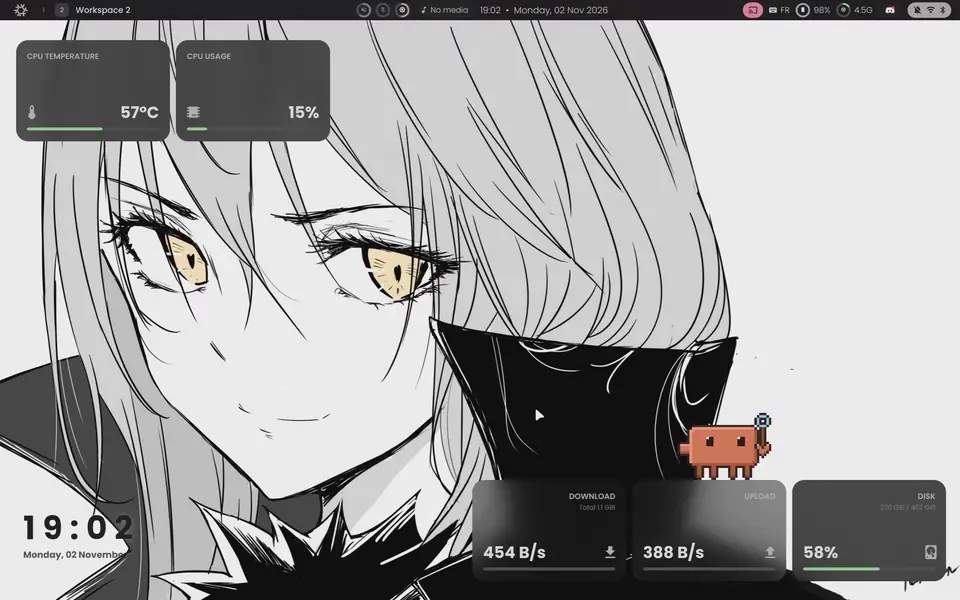</td>
  </tr>
  <tr>
    <td>He wanders, naps, reads the paper, sips coffee, blows bubbles, plays osu!mania, and listens to music when something is playing.</td>
    <td>Grab him and throw him: he has real platform physics, lands on the widgets, follows them when they move and pokes them for fun.</td>
  </tr>
</table>

Clawd is driven by [Claude Code hooks](https://docs.anthropic.com/en/docs/claude-code/hooks). Every session reports its state, and the crab acts it out: he thinks while Claude thinks, puts on a costume for each tool (detective for reads, glasses and laptop for edits, hard hat for shell commands, explorer for the web, conductor for subagents), and peeks out of the screen corner, waving, when a session waits for your permission. Clicking him focuses the right terminal.

He also reacts to the machine: a fan when the CPU is hot, a battery when charging or nearly empty, an umbrella, snow hat or sunglasses depending on the weather, a nightcap when he sleeps at night, flying packets under heavy traffic, and juggling RAM sticks when memory is nearly full.

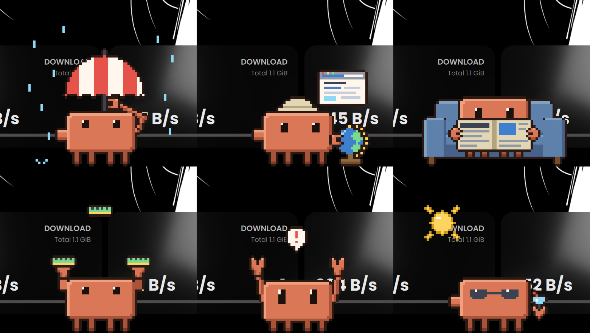

<details>
<summary><b>Every animation</b></summary>
<br>
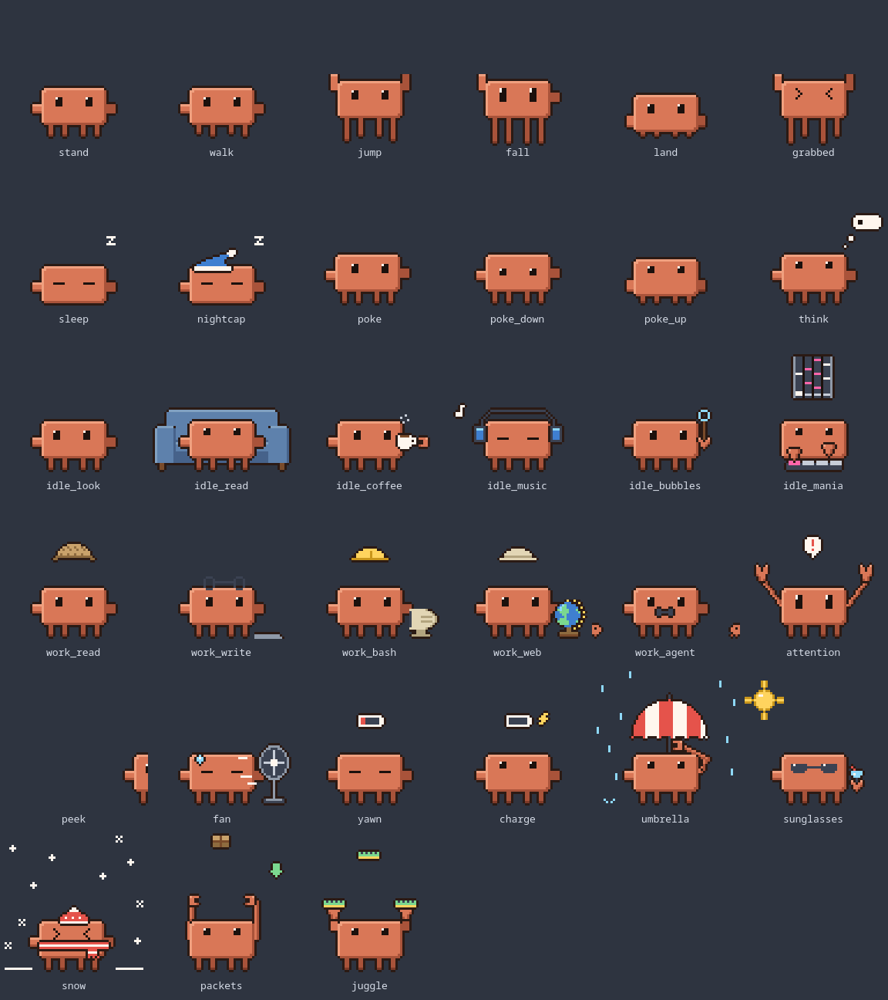

The sprites are generated from code: `assets/src/clawd.py` describes every frame, Aseprite builds the sheet, and `assets/src/showcase.py` renders this grid.
</details>

## Hardware

| | |
| --- | --- |
| Laptop | MSI Pulse 16 AI C1VGKG |
| CPU | Intel Core Ultra 7 155H |
| GPU | Intel iGPU (primary) + NVIDIA GeForce RTX 4070 Laptop (PRIME offload) |
| RAM | 32 GB DDR5 |
| Display | internal `eDP-1`, 2560x1600 @ 240 Hz, scale 1.6 |

## Usage

```bash
rebuild                      # sudo nixos-rebuild switch --flake /etc/nixos#nixos
update                       # nix flake update + rebuild
cleanup                      # sudo nix-collect-garbage -d
nix fmt                      # format every .nix file (nixfmt-tree)
nixos-rebuild build --flake .#nixos   # build without switching, result in ./result
```

If the Quickshell greeter breaks, pick the `tuigreet` specialisation in the boot menu (hold <kbd>Space</kbd> during boot, the timeout is 0).

## Under the hood

<details>
<summary><b>Repository layout</b></summary>

```
.
├── flake.nix                     # inputs, nixosSystem, home-manager wiring, formatter
├── hosts/nixos/
│   ├── default.nix               # hostname, stateVersion, imports modules/
│   ├── vars.nix                  # shared values: user name, monitor spec, monitorLua helper
│   └── hardware-configuration.nix
├── modules/                      # NixOS (system) modules
│   ├── core/                     # boot, nix settings + overlays, locale, networking, users, security
│   ├── hardware/                 # nvidia, power (auto-cpufreq, power profiles), audio, bluetooth
│   ├── desktop/                  # Hyprland + portals, greetd/Quickshell greeter, fonts, Clawd hooks, desktop CLI tools
│   ├── services/                 # ollama + AI tools, gaming, docker, nix-ld
│   └── packages.nix              # base CLI tools available to every user (and root)
├── home/                         # home-manager modules
│   ├── default.nix               # user identity, session variables
│   ├── desktop/                  # Hyprland (+ hyprland.lua), Quickshell service, hypridle, power scripts, screenshot
│   ├── shell/                    # zsh, starship, kitty, direnv, git, ssh/keychain
│   ├── theming.nix               # GTK, Qt (qtct), cursor
│   ├── apps.nix                  # GUI apps, Firefox, Steam (NVIDIA) desktop entry, Aseprite
│   ├── dev.nix                   # toolchains, IDEs, CLI dev tools
│   └── quickshell/               # Quickshell QML sources (shell + greeter), not a Nix module
└── docs/media/                   # README screenshots and clips
```

| What | Where |
| --- | --- |
| Value shared by system and home (user, monitor) | `hosts/nixos/vars.nix`, received as the `host` module argument |
| Tool needed by root, system services or the greeter | `modules/packages.nix` or the relevant system module |
| Tool called by Hyprland binds, Quickshell or hypridle | `modules/desktop/default.nix` |
| Personal app or dev tool | `home/apps.nix` or `home/dev.nix` |
| Environment variables for NVIDIA offload | `nvidiaOffloadEnv` module argument, defined in `modules/hardware/nvidia.nix` |
</details>

<details>
<summary><b>NVIDIA and boot</b></summary>

- PRIME offload: the Intel iGPU drives the display, the dGPU is only used through `nvidia-offload <cmd>` (or the `nvidiaOffloadEnv` variables). Fine-grained power management lets the dGPU power off when idle.
- The NVIDIA kernel modules are removed from `modules-load.d` and loaded asynchronously by a udev rule (`modprobe nvidia_drm` when the PCI device appears), so loading them no longer blocks `sysinit.target`.
- `nvidia-drm fbdev=0` is set in `modprobe.d/zz-…` so it overrides the NixOS default.
- Steam has an extra "Steam (NVIDIA)" launcher; osu! stable is wrapped with the offload variables directly.
- The NVMe drive sits behind Intel VMD (locked on in the BIOS), which drops one interrupt at boot. With the default 30 s NVMe I/O timeout the initrd stalled; `nvme_core.io_timeout=2` (in `modules/hardware/power.nix`) brings this down to a couple of seconds.
</details>

<details>
<summary><b>Power profiles</b></summary>

| Profile | CPU | Wi-Fi power save | Refresh rate | Animations / blur |
| --- | --- | --- | --- | --- |
| performance | auto-cpufreq, turbo on | off | always 240 Hz | on |
| balanced | auto-cpufreq, turbo on | on | 240 Hz on AC, 60 Hz on battery | on |
| economy | auto-cpufreq stopped, turbo off, 800 MHz cap, dGPU autosuspend | on | always 60 Hz | off |

Quickshell (`PowerProfileService.qml`) runs `~/.local/bin/set-power-profile <mode>`, which

1. runs the root part, `power-profile-apply` (allowed without password through a sudo rule),
2. stores the mode in `~/.local/share/power-profile`,
3. applies the refresh rate and visual effects through `hyprctl eval`.

The `adaptive-refresh-rate` user timer runs every 10 s and switches between 240 Hz and 60 Hz depending on the charger, but only in the `balanced` profile and never while osu!/wine is running. auto-cpufreq also limits battery charge to 20–80 %.
</details>

<details>
<summary><b>Desktop, greeter and Clawd plumbing</b></summary>

- Hyprland reads `~/.config/hypr/hyprland.lua`, generated by home-manager: monitor and cursor lines from Nix, then `require("config")` loads `home/desktop/hyprland.lua`. `hyprctl dispatch` takes Lua (`hl.dsp.*`), not the legacy dispatcher syntax.
- Quickshell runs as a systemd user service. `~/.config/quickshell` is an out-of-store symlink to `home/quickshell/`, so QML edits apply without a rebuild. Runtime files written by Quickshell (`settings.json`, generated GTK/Qt/terminal colors, wallpaper selection) are gitignored.
- Quickshell IPC drives the launcher, clipboard, wallpaper picker, power menu, lock screen, media/brightness keys and Clawd: `qs ipc call <target> <function>`.
- hypridle: screen off after 2 min, lock after 3 min (Quickshell lock screen), suspend after 10 min.
- greetd starts a minimal Hyprland (`modules/desktop/greeter.nix`) that runs `home/quickshell/greeter.qml`. Its state (avatar, last session) lives in `/var/lib/jaqc-greeter`. The greeter reads the QML straight from `/etc/nixos`, so the repo must stay at that path.
- Clawd: `modules/desktop/clawd.nix` installs `clawd-hook` and registers it in the Claude Code managed settings. The hook keeps one file per session under `$XDG_RUNTIME_DIR/clawd` and merges them into `state.json` (most urgent session wins, dead sessions are dropped by PID), which `ClawdService.qml` watches. Try `qs ipc call crab perform umbrella`.
</details>

## Reusing this config

This configuration targets one specific laptop. Before reusing it, adapt `hosts/nixos/vars.nix` (user, monitor), `hosts/nixos/hardware-configuration.nix`, the PRIME bus IDs in `modules/hardware/nvidia.nix`, the dGPU PCI path in `modules/hardware/power.nix`, and the AZERTY bindings in `home/desktop/hyprland.lua`.
